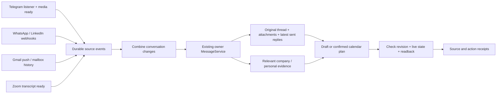

# Event-driven correspondence

**Status:** central receiver deployed; source cutover and live delivery verification in progress.
**Date:** 5 November 2026
**Owner:** Mik

## Context

Calendar capture and reply drafting need the same conversation, identities, current agreements and project facts. Independent inbox jobs currently fetch different context and can produce stale drafts. A periodic whole-inbox scan also waits unnecessarily and repeatedly reads unchanged conversations.

The existing Home already has a private owner conversation, SQLite, one serialized MessageService queue, native Gmail/Calendar tools, Telegram history/drafts and scoped company/personal brain connections. Reuse them. Keep original messages and documents in their existing services, following the [second-brain decision](second-brain-2026-11-02.md).

## Decision

1. **Receive facts, not prompts.** A source-specific credential binds provider/account/space. The receiver accepts only event IDs, conversation/message references, kind and source time. Unipile signatures cover the raw body; account/provider must match. Native source text never becomes a control-plane request.
2. **Persist before acknowledging.** SQLite deduplicates source/event IDs. A reused ID with changed content is rejected. HTTP acknowledgment proves durable receipt, not that a draft or calendar entry exists.
3. **One writer.** A 45-second quiet window combines a conversation burst, capped at two minutes. A timer exists only while accepted work is pending. The normal path never scans inboxes. All actions enter the existing private owner queue, behind any active manual request.
4. **Retrieve once for both actions.** Read the original thread/branch, relevant earlier agreements, actual attachment contents and subsequent human replies. Resolve identities before targeted retrieval from the existing brains. Personal and company connections retain their scopes. A draft includes only facts appropriate for its recipient.
5. **Check again before saving.** `correspondence_checkpoint` checks the running receipt, live authorization and whether newer events arrived. Re-read provider state too. Preserve human or unknown drafts, sent replies and deliberate deletions. Telegram has no conditional native draft write; a read-before-write check cannot eliminate the editor race. Keep a private proposal when that guarantee is required.
6. **Calendar copies are private.** Confirmed personal/work appointments only, no attendees or invitations. Reserve 60 minutes when only duration is missing, and label it reserved. Match existing calendar invitations and cross-channel source aliases before creating. Accepted changes update the same managed event. Read back every mutation.
7. **No blind retry after uncertain actions.** Pending events survive a restart. An interrupted run with a message receipt moves to review; reconcile the real draft/calendar before retrying. A newer source event can revisit the conversation with the existing receipt ledgers. Each receipt binds its own source configuration and the shared owner/audience/calendar policy. Changing an unrelated source preserves accepted work; changing its own credentials/account or the shared policy revokes it. Unchanged receipts from the first release migrate on restart only while their original owner grant remains valid.

## Source contracts

| Source | Normal trigger | Recovery / activation constraint |
| --- | --- | --- |
| Telegram | Existing Telethon new/edit/delete callbacks; late media readiness | Transactional outbox, immediate Celery wakeup; existing beat retries only pending deliveries. Owner account only; channels excluded. No historic media replay. |
| WhatsApp / LinkedIn | Unipile `message.new`, `message.update`, `message.delete`, including outgoing replies | Exact account subscriptions and signed webhook secrets. Registering endpoints needs a service API key. Keep that setup key out of the model's runtime connection. |
| Gmail | Unipile Google `email.new` and `email.delete`, then native Gmail full-thread read | Read-only Google connection requires owner consent. Native Gmail remains the draft writer. Signed events normalize native message/thread IDs; deletion without a thread resolves against accepted receipts. Ignore draft events to avoid a feedback loop. Native connected tools alone do not expose mailbox push. |
| Zoom, personal and work | Existing pipeline's transcript/card-ready event | Reuse its durable webhook outbox and scoped recording tools. Resolve future agreements from the actual transcript, not its summary or recording start time. |

Unipile's [webhook contract](https://developer.unipile.com/v2.0/docs/configure-a-webhook) requires a fast acknowledgment and raw-body signature verification. Its [message events](https://developer.unipile.com/v2.0/reference/event-types-1) include changes made from other devices. Google's [Gmail push contract](https://developers.google.com/workspace/gmail/api/guides/push) requires Pub/Sub, history handling and watch renewal.

## Alternatives and tradeoffs

| Option | Complexity / cost | Decision |
| --- | --- | --- |
| Frequent whole-inbox agent jobs | Small setup; repeated reads/model work, delayed reactions and competing draft writers | Keep the new polling job paused. Existing briefings may report status, but should not remain a second automatic draft writer after cutover. |
| Separate agents and memory stores per channel | More services, duplicated context, cross-channel coordination | Reject. The current model and existing scoped brains already provide the reasoning/retrieval path. |
| Durable source events into the existing Home | Small receipt table and producer outboxes; source-specific setup remains necessary | Selected. Restart/replay handling has concrete value, without adding a broker or another model runtime to Home. |

## Rollout and proof

- Local tests cover replay, coalescing, interrupted runs, changed authorization, stale revisions, account scoping, signature tampering and a proxy listener that cannot expose Home administration.
- Producer tests must show that source changes and their outbox event commit together, that foreign owners are excluded, and that retry preserves the exact event ID.
- Deploy receiver first, verify its source-scoped HTTPS route, then activate producers individually. Preserve the metrics Mini App, review Home, existing calendars and native drafts.
- For each source, trace a real changed conversation through ingestion, context retrieval and a verified provider result. Simulated webhooks or connector badges do not prove a live subscription.
- Retire competing draft writers only after their replacement is verified. Record pending provider setup honestly; no claim that every channel is live from a passing unit suite.

## Operations

`POST /v1/correspondence` is owner-only configuration. `GET /v1/correspondence` reports source identities and processing receipts without credentials. `POST /hooks/correspondence/<source>` accepts only its configured source credential; it cannot call Home management. `OPENSTRUDEL_HOOKS_PORT` is an optional proxy listener exposing only these source routes.

Internal event shape: `{id, threadId, messageId?, type, occurredAt}`. Types are `message.new`, `message.updated`, `message.deleted`, `transcript.ready`. No source can supply its own account, audience, prompt or destination. Source IDs and times are evidence, not instruction.

Sources may explicitly select `auth: "unipile"` for Gmail, WhatsApp or LinkedIn. Omitted auth preserves the original defaults: WhatsApp/LinkedIn use Unipile signatures, internal producers use bearer credentials. Unipile's generated signing secrets are 30 characters; internal bearer credentials must have at least 32. Gmail additionally requires `account_provider: "google"` and the exact connected account ID.

The production proxy forwards only `/hooks/correspondence/*` to the isolated listener on 7791 with upstream `Host: localhost`; source authentication still applies and incoming Origin headers remain intact. It does not expose the Home API. When Caddy mounts an individual config file, an atomic host-side replacement can leave the container on the old inode: validate and reload the exact updated file inside the container, then verify the public route.

The private `correspondence/state.json` and `calendar-capture/state.json` hold action receipts and pending evidence. They are not another message archive. A completed event run does not imply every requested action succeeded; the external readback remains the authority.

### Verified on 5 November

- OpenStrudel receiver releases [#98](https://github.com/mikwiseman/openstrudel/pull/98) and [#99](https://github.com/mikwiseman/openstrudel/pull/99) are merged and deployed. The metrics and isolated review routes remain available.
- A real Gmail source reference traversed the public HTTPS receiver and shared queue. The workflow read the relevant 71-message thread, resolved the company client and read an original company transcript. It recognized the existing private calendar entry and made no duplicate or draft mutation. An independent Google Calendar read confirmed the agreed start, 60-minute reserved duration, original meeting link, private visibility and no attendees. This proves central processing; it does not yet prove a Gmail push subscription.
- Account-scoped WhatsApp/LinkedIn subscriptions are registered; actual signed delivery and processing must be checked separately. Telegram and Zoom producers are merged in [wai-telegram #59](https://github.com/mikwiseman/wai-telegram/pull/59) and [waiwai #240](https://github.com/mikwiseman/waiwai/pull/240).
