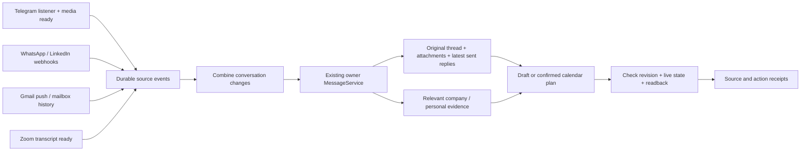

# Event-driven correspondence

**Status:** central workflow deployed; live Telegram, WhatsApp, native Gmail and Zoom processing verified. The former Gmail draft task is paused. LinkedIn awaits its first delivery.
**Date:** 5 November 2026
**Owner:** Mik

## Context

Calendar capture and reply drafting need the same conversation, identities, current agreements and project facts. Independent inbox jobs currently fetch different context and can produce stale drafts. A periodic whole-inbox scan also waits unnecessarily and repeatedly reads unchanged conversations.

The existing Home already has a private owner conversation, SQLite, one serialized MessageService queue, native Gmail/Calendar tools, Telegram history/drafts and scoped company/personal brain connections. Reuse them. Keep original messages and documents in their existing services, following the [second-brain decision](second-brain-2026-11-02.md).

## Decision

1. **Receive facts, not prompts.** A source-specific credential binds provider/account/space. The receiver accepts only event IDs, conversation/message references, kind and source time. Unipile signatures cover the raw body; account/provider must match. Native source text never becomes a control-plane request.
2. **Persist before acknowledging.** SQLite deduplicates source/event IDs. A reused ID with changed content is rejected. HTTP acknowledgment proves durable receipt, not that a draft or calendar entry exists.
3. **One writer.** A 45-second quiet window combines a conversation burst, capped at two minutes. A timer exists only while accepted work is pending. The normal path never scans inboxes. All actions enter the existing private owner queue, behind any active manual request.
4. **Retrieve once for both actions.** Read the original thread/branch, relevant earlier agreements, actual attachment contents and subsequent human replies. Resolve identities before targeted retrieval from the existing brains. Personal and company connections retain their scopes. A draft includes only facts appropriate for its recipient.
5. **Check again before saving.** `correspondence_checkpoint` checks the running receipt, live authorization and whether newer events arrived. Re-read provider state too. Preserve human or unknown drafts, sent replies and deliberate deletions. Telegram has no conditional native draft write; a read-before-write check cannot eliminate the editor race. Keep a private proposal when that guarantee is required.
6. **Calendar copies are private.** Confirmed personal/work appointments only, no attendees or invitations. Reserve 60 minutes when only duration is missing, and label it reserved. Match existing calendar invitations and cross-channel source aliases before creating. Accepted changes update the same managed event. Read back every mutation.
7. **No blind retry after uncertain actions.** Pending events survive a restart. An interrupted run with a message receipt moves to review; reconcile the real draft/calendar before retrying. A newer source event can revisit the conversation with the existing receipt ledgers. Each receipt binds its own source configuration and the shared owner/audience/calendar policy. Changing an unrelated source preserves accepted work; changing its own credentials/account or the shared policy revokes it. Unchanged receipts from the first release migrate on restart only while their original owner grant remains valid.

## Source contracts

| Source | Normal trigger | Recovery / activation constraint |
| --- | --- | --- |
| Telegram | Existing Telethon new/edit/delete callbacks; late media readiness | Transactional outbox, immediate Celery wakeup; existing beat retries only pending deliveries. Owner account only; channels excluded. No historic media replay. Resolve the numeric event chat ID through owner-scoped `search_chats`, then use its internal UUID for reads/drafts. |
| WhatsApp / LinkedIn | Unipile `message.new`, `message.update`, `message.delete`, including outgoing replies | Exact account subscriptions and signed webhook secrets. Registering endpoints needs a service API key. Keep that setup key out of the model's runtime connection. |
| Gmail | Native Gmail `watch` → Google Cloud Pub/Sub → incremental `history.list` → the same receiver | Live for the owner mailbox with `gmail.metadata`; the existing Gmail connection reads bodies and saves drafts. Google OIDC, persisted cursor, deduplicated message/thread IDs, draft-only filtering and daily watch renewal are verified. See the [setup and recovery runbook](gmail-push.md). |
| Zoom, personal and work | Existing pipeline's transcript/card-ready event | Reuse its durable webhook outbox and scoped recording tools. Resolve future agreements from the actual transcript, not its summary or recording start time. |

Unipile's [webhook contract](https://developer.unipile.com/v2.0/docs/configure-a-webhook) requires a fast acknowledgment and raw-body signature verification. Its [message events](https://developer.unipile.com/v2.0/reference/event-types-1) include changes made from other devices. Google's [Gmail push contract](https://developers.google.com/workspace/gmail/api/guides/push) requires Pub/Sub, history handling and watch renewal.

## Alternatives and tradeoffs

| Option | Complexity / cost | Decision |
| --- | --- | --- |
| Frequent whole-inbox agent jobs | Small setup; repeated reads/model work, delayed reactions and competing draft writers | Keep the new polling job paused. Existing briefings may report status, but should not remain a second automatic draft writer after cutover. |
| Separate agents and memory stores per channel | More services, duplicated context, cross-channel coordination | Reject. The current model and existing scoped brains already provide the reasoning/retrieval path. |
| Durable source events into the existing Home | Small receipt table and producer outboxes; source-specific setup remains necessary | Selected. Restart/replay handling has concrete value, without adding a broker or another model runtime to Home. |

## Rollout and proof

- Local tests cover replay, coalescing, interrupted runs, changed authorization, stale revisions, account scoping, signature tampering and a proxy listener that cannot expose Home administration.
- Producer tests must show that source changes and their outbox event commit together, that foreign owners are excluded, and that retry preserves the exact event ID.
- Deploy receiver first, verify its source-scoped HTTPS route, then activate producers individually. Preserve the metrics Mini App, review Home, existing calendars and native drafts.
- For each source, trace a real changed conversation through ingestion, context retrieval and a verified provider result. Simulated webhooks or connector badges do not prove a live subscription.
- Retire competing draft writers only after their replacement is verified. Record pending provider setup honestly; no claim that every channel is live from a passing unit suite.

The 45-second quiet window is a minimum processing delay, not an end-to-end latency guarantee. A busy owner queue or slow source read can add delay. Webhook receipt, completed model run and verified external result are separate states.

## Operations

`POST /v1/correspondence` is owner-only configuration. `GET /v1/correspondence` reports source identities and processing receipts without credentials. `POST /hooks/correspondence/<source>` accepts only its configured source credential; it cannot call Home management. `OPENSTRUDEL_HOOKS_PORT` is an optional proxy listener exposing only these source routes.

Internal event shape: `{id, threadId, messageId?, type, occurredAt}`. Types are `message.new`, `message.updated`, `message.deleted`, `transcript.ready`. No source can supply its own account, audience, prompt or destination. Source IDs and times are evidence, not instruction.

The deployed receiver also supports signed Unipile Google events, but that path was not activated for Gmail. Native Google push is the selected direction; Unipile remains the existing WhatsApp/LinkedIn adapter. Omitted auth uses Unipile signatures for WhatsApp/LinkedIn and bearer credentials for internal producers. Unipile signing secrets are 30 characters; internal bearer credentials require at least 32.

Resumed native Codex threads retain their original dynamic-tool list. The per-turn Home MCP bridge therefore includes the currently authorized `unipile_accounts` and `unipile_read` schemas alongside the correspondence checkpoint. This gives an existing owner chat the verified V2 reader without resetting its history or exposing a generic provider request executor.

The production proxy forwards only `/hooks/correspondence/*` to the isolated listener on 7791 with upstream `Host: localhost`; source authentication still applies and incoming Origin headers remain intact. It does not expose the Home API. When Caddy mounts an individual config file, an atomic host-side replacement can leave the container on the old inode: validate and reload the exact updated file inside the container, then verify the public route.

The private `correspondence/state.json` and `calendar-capture/state.json` hold action receipts and pending evidence. They are not another message archive. A completed event run does not imply every requested action succeeded; the external readback remains the authority.

### Verified on 5 November

- OpenStrudel receiver releases [#98](https://github.com/mikwiseman/openstrudel/pull/98), [#99](https://github.com/mikwiseman/openstrudel/pull/99), [#100](https://github.com/mikwiseman/openstrudel/pull/100) and [#101](https://github.com/mikwiseman/openstrudel/pull/101) are merged and deployed at `47339786aab8`. Stored-data checks and SQLite integrity passed; the isolated review container was unchanged. The metrics and review routes returned HTTP 200 after deployment. The latest rollback snapshot is marked healthy.
- A real Gmail source reference traversed the public HTTPS receiver and shared queue. The workflow read the relevant 71-message thread, resolved the company client and read an original company transcript. It recognized the existing private calendar entry and made no duplicate or draft mutation. An independent Google Calendar read confirmed the agreed start, 60-minute reserved duration, original meeting link, private visibility and no attendees. This proves central processing; it does not yet prove a Gmail push subscription.
- WhatsApp's actual signed `message.update` delivery received HTTP 202 in 222 ms after a targeted replay of the initial route failure. The resumed worker used the native V2 reader, read the conversation and latest source version, searched both permitted brains, and kept an unverified identity match out of the proposed reply. Its private Home reply proposal is visible. No future time was agreed, so no calendar event was created. Nothing was sent.
- LinkedIn's account-scoped subscription is enabled. No provider delivery has arrived yet; registration alone is not end-to-end proof.
- Telegram's live listener delivered 131 real events through its durable outbox, with zero undelivered rows at the live check. Source retries recovered receiver downtime without changing event IDs. The worker exposed a numeric-ID/internal-UUID mismatch; [wai-telegram #61](https://github.com/mikwiseman/wai-telegram/pull/61) adds an exact owner-scoped lookup, with the original failure reproduced before the fix. The exact-ID reader is deployed at `9369bf93da54`; production [run 42017019455](https://github.com/mikwiseman/wai-telegram/actions/runs/42017019455) passed. Queued events were released. The recovered private-chat run read both changed messages, the reply parent, the latest owner reply and a subsequent call record. It searched only the personal brain and correctly made no draft or calendar change: the owner had already replied and the call record was not a future appointment. The former resolution gap is cleared.
- Zoom producers are deployed from [waiwai #240](https://github.com/mikwiseman/waiwai/pull/240). Two existing real transcript-ready events were delivered only to the new personal/work targets, both HTTP 202. The worker read the full original transcripts through their respective connections. A past personal plan matched an existing event; unconfirmed work timing stayed pending. Existing notification targets were not replayed.
- Native Gmail releases [#104](https://github.com/mikwiseman/openstrudel/pull/104) and [#105](https://github.com/mikwiseman/openstrudel/pull/105) are merged and deployed at `1848e6bc2ffc`. Real Google deliveries exposed numeric history IDs; the failure was reproduced before adding exact safe-integer normalization. All 20 targeted tests and the production Node 24 image check passed. Google-originated notifications then received HTTP 202, including retries after receiver downtime; the persisted cursor caught up to `12411351` with no pending receipts or recovery error. An internally published diagnostic message was excluded from provider-delivery evidence.
- A real incoming Gmail message generated two history events, combined into one shared run. The worker read the complete original thread, re-read its current version, and recorded a current checkpoint. It correctly classified a newsletter as requiring no reply or calendar entry; its advertised date was not treated as an agreed appointment. The run completed at 18:02 UTC. The earlier company-thread/calendar check above remains the evidence for contextual appointment deduplication; this live push check did not create a draft or calendar event.
- Gmail was not connected to Unipile. Its metadata-only connection is saved in 1Password; production reads a private configuration file. The old “Черновики ответов Gmail” task was paused only after the live run completed, with the Paused state and success notification read back. All 24 existing Gmail drafts retained their draft, message and thread IDs. The new 15-minute calendar polling schedule remains paused.

The installed correspondence skill has digest `5cac6fddfd4562f3448bb3a262281cc526607301b7aa8a4624a9eeb7d6fb98e8`. Its event path explicitly resolves Telegram IDs directly; inbox review remains a separate workflow. The skill update waited for the active turn to finish.

### Draft writer cutover

WAI Messages automatic drafting is disabled. Readback confirmed all 137 existing drafts retained their exact text, source message and revision; monitoring remains enabled for its inbox UI. WaiClaw's “Кто ждёт ответа” schedule is now read-only, with its weekday 10:30/15:30 Moscow cadence and private delivery unchanged. Other schedules were preserved. The existing morning and legal briefings were already read-only. Gmail's former event-triggered draft task is paused; native Google push now feeds the shared writer.

### Native Gmail decision

Unipile is not required for Gmail. Google supports push delivery and incremental history with the `gmail.metadata` scope; the event adapter need not read email bodies. The existing managed Gmail tools remain responsible for full thread reads and native drafts. Google requires watch renewal at least every seven days and recommends daily renewal; this is subscription maintenance, not repeated inbox scanning. Lost notifications need history reconciliation, with an explicit recovery path for an expired cursor.

The available Gmail tools do not expose `watch` or `history.list`, so Home contains the small metadata adapter. The existing WAI Google project and owner-specific OAuth connection back its authenticated Pub/Sub subscription. An existing WAI School OAuth item and push implementation belong to `hi@wai.school`; they were not repurposed for the owner mailbox.
