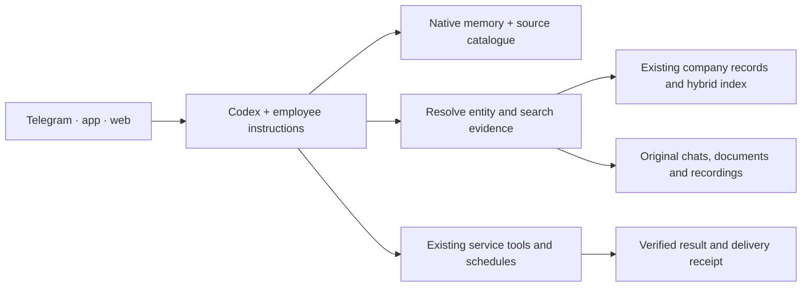

# Second brain · 2 November 2026

Status: implementation and evaluation in progress. This updates the [19 October decision](memory-and-limits-2026-10-19.md). It does not claim that every source has been indexed or every live employee has passed acceptance.

## Decision

Keep Codex as the agent engine. Keep authoritative records in their existing systems. Use the existing company PostgreSQL search index and small local source catalogues to retrieve evidence on demand. Native Codex memory supplies useful preferences and working context; it does not become the authority for contracts, payments, permissions or completed actions.

The product should feel like one capable assistant. Internally, four responsibilities stay clear:

1. **Evidence:** original messages, recordings, transcripts, files and external records, with source IDs, dates and access rules.
2. **Current state:** canonical entities and aliases, explicit corrections, obligations and actual action/delivery receipts. A retrieved old promise is not proof that it remains open or was completed.
3. **Retrieval:** exact names and identifiers plus semantic search, filtered by access and relevant entity/project, followed by reading the source. Indexes and summaries are rebuildable.
4. **Execution:** native Codex tools, delegation and compaction; existing OpenStrudel schedules and durable delivery. Completion requires a receipt from the system that did the work.

No separate always-running memory agent, general-purpose graph server, or second scheduling system is being added in this revision. That is a deployment decision, not a rule against external tools. A component earns its place by improving measured user tasks enough to justify its latency, cost and operational burden.

## What the current system already has

- Audience/account-specific native Codex memories and a bounded idle-runtime cache.
- Owner-only source catalogues; employee and group turns do not inherit all of the owner's sources.
- PostgreSQL/pgvector semantic retrieval combined with full-text ranking through reciprocal rank fusion.
- Central documents and entities with canonical IDs, aliases, source metadata, revisions, optimistic concurrency and mutation keys.
- Search invalidation in the same transaction as a document correction or archival.
- Project/personal access filters before retrieval and a second permission check before returning source passages.
- Native schedules, operation incidents and Telegram delivery receipts.

These are the starting point. A new vendor's advertised feature is not evidence that OpenStrudel needs a second implementation of it.

## Findings from current architectures

| Approach | Useful idea | Fit here |
| --- | --- | --- |
| [Codex native memories](https://learn.chatgpt.com/docs/customization/memories) | Selective background recall beside the native agent runtime | Keep enabled within the intended audience. Required rules remain in explicit instructions. Native extraction can be delayed or skipped. |
| [Databricks MemCurrent, 20 October](https://www.databricks.com/blog/memcurrent-designing-persistent-memory-production-agents) | Preserve original traces, derive compact memory, retrieve only relevant context | Adopt the separation, using existing storage rather than introducing Lakebase. Its internal benchmark is not a comparison on our tasks. |
| [Zep Context API, October](https://www.getzep.com/blog/what-shipped-in-the-context-api/) and [two timelines](https://www.getzep.com/blog/context-graphs-two-timelines-every-fact/) | Stable identity; distinguish when something applied from when the system learned it | Use source IDs and dated corrections. Commercial Context API features must not be assumed to exist in the OSS Graphiti library. |
| [Graphiti](https://github.com/getzep/graphiti) | Temporal relationships and hybrid graph retrieval | Candidate when multi-hop relationship questions beat the simpler baseline. Requires extraction, graph storage and operational ownership. |
| [Hindsight](https://hindsight.vectorize.io/developer/retrieval) | Semantic, lexical, relationship and temporal retrieval with source evidence | Useful comparison architecture. Whole retain/reflect pipelines would add model work beside Codex; evaluate only after baseline gaps are measured. |
| [Mem0](https://docs.mem0.ai/open-source/overview) | A configurable memory library/server | Possible cross-runtime memory component; not required to operate our existing Codex memory and company index. |
| [Letta MemFS](https://docs.letta.com/concepts/memfs) | Inspectable files, a small root index and progressive access to deeper memory | Adopt the inspectability. Do not adopt another agent runtime merely to get a file index. |
| [QMD 2.8.3](https://github.com/tobi/qmd/blob/v2.8.3/README.md) | Local lexical + vector retrieval and reranking, with one shared MCP server | Best small local experiment if real file-retrieval misses remain. Measure its loaded-model RAM and latency. Do not load a separate instance per employee. Earlier five-query lexical smoke checks did not test hybrid quality. |
| [Wenlan 0.20.6](https://github.com/wenlan-app/wenlan/blob/v0.20.6/README.md), [Microsoft LLM Wiki 1.0.1](https://github.com/microsoft/llmwiki/blob/v1.0.1/README.md) | Readable source-backed pages and explicit source/derived separation | Useful presentation and provenance patterns. A generated page or citation is not proof of a current operational fact. |
| [Microsoft GraphRAG](https://microsoft.github.io/graphrag/query/overview/) | Entity-local and corpus-wide synthesis | Consider for broad research across many sources, not as the initial authority for obligations and payments. Global synthesis adds indexing and query cost. |
| [OpenAI Retrieval](https://developers.openai.com/api/docs/guides/retrieval) | Hosted file search with attribute filters | An alternative deployment choice. It would duplicate the company index today and is separate from Codex subscription memory. |
| [MemOS](https://memos-docs.openmem.net/open_source/home/architecture/) | Explicit memory organization and lifecycle | More orchestration than needed for the current Codex-based product. Some advanced memory types are roadmap capabilities, not capabilities we verified. |

[Anthropic's context-engineering guidance](https://www.anthropic.com/engineering/effective-context-engineering-for-ai-agents) supports small, relevant context and capable tools. [Contextual retrieval](https://www.anthropic.com/research/contextual-retrieval) is useful when a chunk loses its document context. These are patterns to evaluate, not reasons to copy a complete harness. [MemoryArena](https://arxiv.org/abs/2602.16313) also cautions against treating conversation-recall benchmarks as proof of reliable multi-session actions.

## Corrections, identity and time

Use an external ID or an explicit canonical ID to establish identity. Aliases, transliteration and speech variants help locate candidates; a similar name alone must never merge two people, counterparties or contracts. Where a source has no verified identity, retain that uncertainty.

Keep both source/event time and the time a correction was recorded. A historical answer must be labelled historical. An explicit later correction supersedes the earlier claim while retaining its provenance and revision. Archive, restore and partial edits must preserve unrelated fields. A cleared operational incident must correspond to recovery of that same task, rather than any successful conversation.

Use source-system state for money, document execution and calendar changes. Payment is not contract acceptance; a prepared draft is not a signed or sent document; a free Zoom room is not evidence that attendees are free. Unknown calendar access is not availability. Recheck live state immediately before executing a consequential change.

## Evaluation and acceptance

Use realistic tasks across the personal assistant, work projects, School, finance, legal work and Grant. Keep original expected evidence private. Include name variants, ambiguous identities, contradictions, corrections, old versus current facts, inaccessible sources, voice input, delegation, scheduling, recovery and actual delivery. Do not reduce the whole estate to one project's pilot.

Compare alternatives on the same permitted sources, questions and model. Measure supported answers and useful completed actions, missed/incorrect sources, latency, model cost, process RSS and disk use. Include abstention and denied-access cases. Vendor benchmark scores and the handoff's unexecuted acceptance CSV are not our acceptance results.

Live baseline on 2 November found an important retrieval failure: a broad document question about a named client's acceptance paperwork returned unrelated school transcripts above the client's contract. Passing the existing client filter brought the contract to the top. This supports entity resolution and scoped retrieval before introducing another vector database. The scoped query covered fewer sources; that is not proof of complete legal coverage. Current source files and receipts still need to be read.

Implementation in this revision addresses full-history allocations, retained access to deleted-only generated memories, hidden imported-source copies, case-insensitive alias lookup, partial archival edits and task-specific incidents. Tests and deployment evidence belong in the [current work log](../current-work-2026-11-02.md).

## Rollout rules

Preserve existing data, native schedules, employee instructions, signing protections and the isolated App Review Home. Inspect production differences before building an update. Validate, create a timestamped rollback snapshot, apply atomically, check health and behavior, and roll back on failure. Never overwrite an uncommitted production security patch with a clean main build.

Check memory pressure, swap and free disk during active work. No periodic Codex resource task is required. Delete only identified unused, reproducible caches under the repository's storage policy; never trade source evidence or rollback material for a temporary increase in free space.
