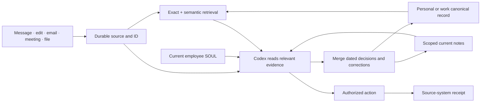

# Personal and work memory · 7 November 2026

Extends [the 2 November architecture](second-brain-2026-11-02.md). One Codex runtime, existing files and databases, existing provider event feeds. No additional memory service or agent loop.

## What belongs where

| Record | Authority and lifecycle |
| --- | --- |
| Employee SOUL | Stable identity, voice and standing role. Existing employee profile is canonical; a stray `SOUL.md` in an attachment cannot replace it. Explicit authorized changes use `update_employee`, which checks the current version before saving. |
| Scoped `MEMORY.md` | Compact current decisions, corrections, preferences and pointers. Read from the actual workspace on every turn, including resumed threads. Scheduled group reports also receive their delivery group's notes, after checking the current binding. Keep it short; link deeper existing Markdown files. |
| Canonical personal/work documents | Shared durable entities and decisions. Existing document tools retain revisions, aliases, sources, mutation keys and optimistic concurrency. Work and personal records stay in their respective spaces. |
| Original evidence | Messages, edits, files, recordings, page-addressed transcripts and delivery receipts. Preserve original bytes and source IDs. OCR, summaries and generated notes are derivatives. |
| Search index | Existing PostgreSQL full-text and vector indexes, plus native file search. Rebuildable from sources; an embedding is neither evidence nor proof that an action happened. |
| Native Codex memory | Selective recall and consolidation within the permitted audience. Useful assistance, not the only store for a correction that must affect tomorrow's report. |

## Learning without identity drift

Each durable note needs the subject, statement, speaker, source ID, source date and any superseded statement. Distinguish what a participant reported from what was independently verified. Preserve disagreements with attribution. A later correction from the relevant person replaces the corresponding older guidance, not unrelated rules. Historical questions still use the historical source.

Use the model's existing native tools to read, merge and verify notes during useful work. Keep source evidence even when compacting working notes. Do not run a second model after every message merely to paraphrase it. Unaddressed group comments remain searchable evidence; relevant corrections are considered when the next answer or scheduled report runs. This does not promise instantaneous semantic consolidation of every comment.

The next turn reloads current notes rather than relying on a session-start snapshot. The injected excerpt is bounded to 16 KB per workspace and explicitly reports truncation. Larger records belong in linked files or canonical documents, retrieved when relevant. Files named `MEMORY.md` that are symlinks are not injected. Notes are quoted knowledge, never authority to expand permissions or send messages.

Personal, company, project and group are access boundaries, not just tags. A family member's correction is relevant family evidence; it does not grant Home administration. A work meeting does not authorize reading personal family files. A scheduled report's history grant is checked again on every history-tool call and revoked when its group assignment changes.

## Event handling and retrieval

Keep native Telegram updates, Gmail Pub/Sub, provider webhooks and the existing meeting notification feed. Save a durable receipt before processing; deduplicate by upstream event ID. Retain edits as source corrections rather than silently rewriting completed requests. A failed download keeps its caption and failed status. A failed transcription keeps the original recording where file access is permitted.

Indexes update after source changes; bounded reconciliation repairs missed index work. Reconciliation is recovery, not the main conversation trigger. Native Gmail remains the Gmail source; do not introduce Unipile solely to duplicate it. Calendar and drafting actions continue through the existing shared workflow and current-source checks.

Resolve entity/project first, search exact identifiers and keywords alongside vectors, then read the original passage. Report source dates and coverage gaps. A low semantic score or missing vector is not proof that the original does not exist. Telegram's archive already has a resumable, bounded embedding repair job and capacity checks; use it within its selected sources rather than adding another vector store.

## Current primary-source comparison

Reviewed 7 November 2026. These are documented designs, not independent verification of vendor performance.

| System | Useful practice | Decision here |
| --- | --- | --- |
| [Hermes persistent memory](https://github.com/NousResearch/hermes-agent/blob/main/website/docs/user-guide/features/memory.md) and [SOUL](https://github.com/NousResearch/hermes-agent/blob/main/website/docs/user-guide/features/personality.md) | Separate stable identity from concise learned notes and searchable history. Hermes freezes its injected memory at session start. | Keep identity distinct. Refresh current scoped notes each turn because these Telegram conversations and schedules live for months. |
| [OpenAI sandbox memory](https://developers.openai.com/api/docs/guides/agents/sandboxes#memory) | Progressive disclosure, persistent workspace, conversation summaries and reusable memory. | Use native Codex capabilities already present. Do not confuse the documented Sandbox Agents SDK with a guarantee about our installed Codex version or ChatGPT's private implementation. |
| [OpenAI Retrieval](https://developers.openai.com/api/docs/guides/retrieval) | Attribute filters and hybrid keyword/embedding ranking. | Existing scoped PostgreSQL retrieval supplies this role; hosted file search would be an alternative, not another mandatory copy. |
| [MemPalace](https://github.com/MemPalace/mempalace) | Verbatim originals, scoped semantic retrieval, idempotent ingestion. | Preserve complete source evidence and search by person/project. Its published retrieval benchmark does not prove reliable actions on our data. |
| [MemPal](https://github.com/ZhangHanDong/mempal) | Inspectable local storage with SQLite, FTS and vectors. | Useful compact architecture; installing it would duplicate the current archive/index. “MemPal” names several projects, so both repositories were reviewed. |
| [GrokBot memory](https://docs.x.ai/grok-bot/bots) and [xAI Collections](https://docs.x.ai/developers/tools/collections-search) | Durable preferences, source-backed retrieval and reusable routines. | Preserve the same separation across model providers. Keep provider-specific memory subordinate to explicit records and access rules. |
| [Messenger's official samples](https://github.com/fbsamples/messenger-platform-samples) | Provider events enter an application through webhooks. | Reuse the existing event workflow; a webhook is transport, not semantic memory or delivery proof. |

## Evidence from this audit

- The family-book originals were absent from the agent's accessible workspace. Both books and their endpapers are now preserved with byte counts and SHA-256 manifests. Searchable derivatives are stored in the personal corpus. Familia opened an original PDF, verified its hash and page count, and read a passage checked against the rendered page.
- A parent's late-October correction existed in Telegram but was missing from the recurring report's notes. It is now retained with its source identity and date, including a revision of the existing personal entity. No private family record was written into the company space; a company-scoped read of the new personal document was denied.
- Scheduled work could read its separate employee conversation while missing the delivery group's feedback. Tests now cover current comments, older paginated comments, resumed-memory refresh and revocation after reassignment.
- Later message edits, replies addressed to other bots, failed media downloads and failed transcription could lose useful context. Tests retain corrections, captions and original recordings without creating extra action requests.
- Grok's generic ACP error could hide a quota failure visible on stderr. Bounded provider diagnostics now preserve the existing specific limit incident; no automatic model switch was added.

Private source IDs, test prompts, receipts and coverage measurements are retained in the local audit directory rather than committed to the public repository. Deployment is verified separately from these source changes.

## Acceptance and extension

Judge improvements by real recall and action tasks: a later correction wins; an older decision beyond the last 50 messages is found; an original page can be checked; a resumed thread sees new notes; a private source stays inaccessible from work; a retry does not create a second action. Track source coverage separately from vector coverage and end-to-end answer quality.

Add a graph only when relationship questions demonstrably fail after entity-scoped hybrid retrieval. Add a reranker only when a fixed set of real questions shows a ranking improvement worth its latency. Add another memory service only if it solves cross-runtime sharing that the existing canonical document tools cannot. Keep source IDs, revisions and access metadata in the interfaces so the index or model can be replaced without migrating the truth into a vendor's opaque memory.
