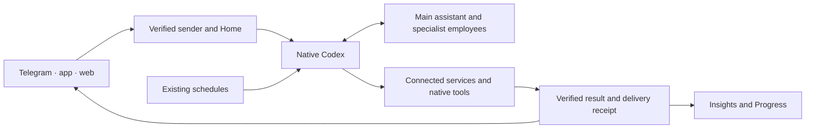
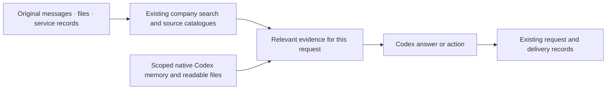

# OpenStrudel in one minute

Codex does the thinking and tool work. OpenStrudel connects it to people, employees, evidence and delivery. An employee is a role, its working context and allowed services; it is not another agent framework.

Ask the main assistant for ordinary work; it can use specialists. For source-code work, use the connected developer employee's own private chat. Its registered checkout runs through native Codex editing and test tools. A test passes only when its command succeeds. Automatic routing from the main assistant into a separately registered project is not implemented yet.

Original sources remain the authority. Existing company search combines text and vector retrieval; no second vector server was added. Native memory carries useful preferences and context. Corrections retain their sources and dates. Private information stays within its verified audience. This does not mean every external source is already fully synchronized.

The existing scheduler starts approved recurring work through the same engine. There is no new memory agent, heartbeat service or 12-hour Codex resource automation. Resource checks happen during active maintenance.

Mobile navigation is Chat, Insights and Progress. Insights lead back to actual results; Discuss prepares an unsent draft. Progress counts real work and shows available account limits. It does not reward token spending or invent time saved.

## Rollout boundary

The backend is live on Wolf. The new mobile source is merged; Mac tests and iOS compilation pass, but remaining iOS UI checks are blocked by local disk headroom. Build 67 remains the published app. See the [work log](current-work-2026-11-02.md) and [mobile acceptance record](mobile-activity.md) for exact checks and limits.
